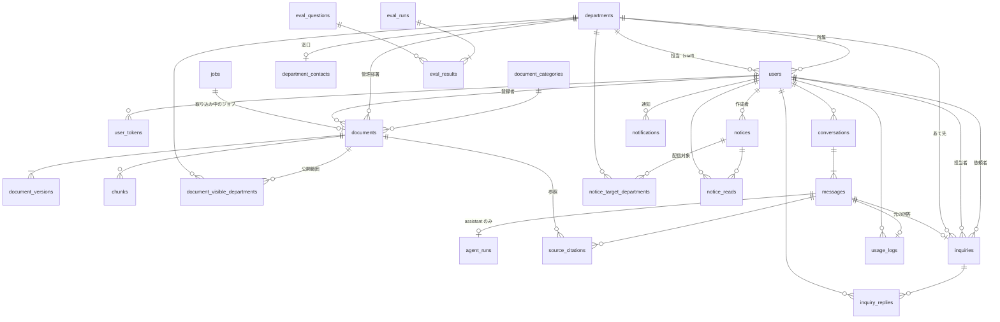

# DB 設計（テーブル設計）

モックアップ（全 14 ページ・55 画面）をもとにした PostgreSQL 17 + pgvector のテーブル設計。

| 元にした資料 | 内容 |
|---|---|
| `frontend/src/pages`・`components` | 各画面が表示・入力・絞り込みに使う項目（すべて突き合わせ済み。5 章） |
| [domain-model.md](domain-model.md) | 集約・状態遷移・守るべきルール（モックアップで作成） |
| [../api-spec.md](../api-spec.md) | 画面と API の取り決め |
| `frontend/src/mocks/db.js` | ダミーデータ（項目名・値の例） |
| プロジェクト計画書 別紙1 | 機能要件（No.1〜30）・非機能要件 |

> **状態**: 設計のみ。実装済みのテーブルは `users` だけ（8 章）。機能を作るときに、このドキュメントに沿ってモデルとマイグレーションを追加する。
>
> **AI との関係**: 資料のベクトル化から回答までの流れと、どのテーブルに何を書くかは [11 章](#11-ai資料のベクトル化検索回答とテーブル) を参照。
>
> **レビュー**: 「画面との突き合わせ」と「設計の品質（整合性・セキュリティ・pgvector・同時実行）」の 2 観点でレビューし、指摘を反映済み（2026-11-09）。

## 1. 方針

| 項目 | 決めたこと | 理由 |
|---|---|---|
| 名前 | テーブルは snake_case の複数形、外部キーは `<単数形>_id`、真偽値は `is_` で始める（[coding-style.md](../development/coding-style.md)） | |
| 主キー | `id`。件数が多くなるテーブル（`chunks`・`messages`・`usage_logs` など）は `bigint`、それ以外は `integer`。どちらも自動採番 | |
| 日時 | すべて `timestamptz`（UTC で保存し、画面で JST に変換）。「年」や「日」の区切りは JST で判定する | |
| 区分値 | PostgreSQL の enum 型は使わず、`varchar` ＋ `CHECK` 制約 | 値の追加がマイグレーションで簡単にできる |
| 削除 | 利用者・会話・資料は**論理削除**（`deleted_at`） | 問い合わせ・利用履歴から名前や過去の質問を表示し続けるため |
| 外部キーの削除時の動作 | 明記がないものは **ON DELETE RESTRICT**。親と一緒に消える子だけ CASCADE | 論理削除が基本なので、物理削除で履歴が消える事故を防ぐ |
| 部署 | 文字列ではなく `departments` マスタを参照する | 部署名の変更・絞り込み・公開範囲の判定を確実にするため |
| 名前のコピー | `userName`・`uploadedBy` などは保存しない。API で JOIN して返す | 二重管理を避ける。例外として、**後から変わってはいけない記録**（根拠資料の引用、問い合わせの依頼者の部署と添付情報、利用履歴）はその時点の値をコピーする |
| jsonb | 画面に表示するだけで、検索・集計に使わない入れ物（次の手続き、問い合わせの提案、検索過程、通知設定）だけに使う | 形が変わりやすく、テーブルを分けると 4 週間の開発では重いため |
| 公開範囲 | `visibility_type`（`all` / `departments`）＋ 部署の中間テーブル | 検索時に SQL だけで絞り込める。公開先の行がなければ誰にも見えない（安全側に倒れる） |
| `updated_at` | SQLAlchemy の `onupdate` は ORM 経由の更新でしか動かない。一括 UPDATE では明示的に設定する | |

## 2. ER 図



`notification_settings`・`inquiry_number_counters` は他と関連を持たない設定用のテーブル。

## 3. テーブル一覧（25 テーブル）

| 区分 | テーブル | 内容 | 主な画面・機能要件 |
|---|---|---|---|
| マスタ | `departments` | 部署 | 全般 |
| | `document_categories` | 資料のカテゴリ | 資料登録・一覧（No.19, 21） |
| アカウント | `users` | 利用者 ✅実装済み（8 章の変更が必要） | ログイン、アカウント管理（No.1, 24〜27） |
| | `user_tokens` | 招待・パスワード再設定のトークン | No.25〜27 |
| ナレッジ | `documents` | 資料（最新の状態） | 資料一覧・編集・削除（No.19〜23） |
| | `document_versions` | 資料の版（ファイルの情報） | 版履歴（No.21） |
| | `document_visible_departments` | 部署限定の資料の公開先 | 公開範囲（No.22） |
| | `chunks` | 資料を分割した本文とベクトル | 検索Agent（No.4） |
| チャット | `conversations` | 会話 | 会話履歴（No.10） |
| | `messages` | 質問と回答 | チャット（No.3, 6, 8, 9） |
| | `agent_runs` | 回答 1 件ごとの AI の実行結果と検索過程 | 検索過程（No.5, 30）・費用の記録 |
| | `source_citations` | 回答の根拠資料 | 根拠資料プレビュー（No.6, 7） |
| 問い合わせ | `inquiries` | 担当部署への問い合わせ | No.11〜15 |
| | `inquiry_replies` | 担当者からの回答 | No.13, 15 |
| | `inquiry_number_counters` | 受付番号の年ごとの連番 | No.12 |
| お知らせ | `notices` | お知らせ | No.16〜18 |
| | `notice_target_departments` | 部署指定の配信先 | No.17 |
| | `notice_reads` | 既読 | No.16, 18 |
| 通知 | `notifications` | 画面内のイベント通知 | 非機能 No.12（画面の追加が必要。7 章） |
| | `notification_settings` | 通知設定（1 行だけ） | 通知設定（No.28） |
| | `department_contacts` | 部署の窓口メールアドレス | 通知設定（No.28） |
| 利用分析 | `usage_logs` | 質問 1 件ごとの利用履歴 | 利用履歴（No.29, 30） |
| worker | `jobs` | バックグラウンド処理のキュー（資料の取り込み・予約配信・通知など） | No.17, 20, 23, 28 |
| 評価 | `eval_questions` | 評価用の質問と正解 | 通常 RAG との比較（計画書のリスク対策⑤） |
| | `eval_runs` | 評価の実行（方式・設定ごと） | 同上 |
| | `eval_results` | 質問ごとの評価結果 | 同上 |

## 4. テーブル定義

表の見方: **PK** 主キー、**FK** 外部キー、**UQ** 一意、**NN** NOT NULL（空欄は NULL 可）。

### 4.1 マスタ

#### departments（部署）
| カラム | 型 | 制約 | 説明 |
|---|---|---|---|
| id | integer | PK | |
| name | varchar(100) | NN, UQ | 例: 人事部 |
| sort_order | integer | NN, 既定 0 | 画面での並び順（マスタ管理の画面はないので初期データで設定） |
| is_active | boolean | NN, 既定 true | 廃止した部署は false（使われている部署は削除できないため） |
| created_at / updated_at | timestamptz | NN, 既定 now() | |

初期データ: 人事部・総務部・経理部・情報システム部・営業部・開発部・マーケティング部（モックアップと同じ）

#### document_categories（資料のカテゴリ）
`departments` と同じ形。初期データ: 就業規則・規程／人事手続き／社会保険・福利厚生／経費・経理／IT・セキュリティ／総務・施設

### 4.2 アカウント

#### users（利用者）
| カラム | 型 | 制約 | 説明 |
|---|---|---|---|
| id | integer | PK | |
| employee_id | varchar(32) | NN | 社員番号 |
| name | varchar(100) | NN | 氏名 |
| email | varchar(255) | NN, CHECK (`email = lower(email)`) | ログイン ID |
| password_hash | varchar(255) | | argon2。招待中は NULL |
| must_change_password | boolean | NN, 既定 false | 初期パスワードで作成したら true。初回ログインで変更を求める（アカウント作成画面） |
| password_changed_at | timestamptz | | これより前に発行したセッションは無効にする（パスワード再設定後のため） |
| department_id | integer | NN, FK → departments | 所属部署 |
| role | varchar(16) | NN, CHECK (`user` / `staff` / `admin`) | 権限 |
| handles_department_id | integer | FK → departments | 対応する問い合わせの部署 |
| status | varchar(16) | NN, CHECK (`active` / `invited` / `suspended`) | |
| created_at / updated_at | timestamptz | NN, 既定 now() | |
| last_login_at | timestamptz | | |
| deleted_at | timestamptz | | 論理削除 |

- `CHECK (role = 'admin' OR (role = 'staff') = (handles_department_id IS NOT NULL))` … staff は必須、user は NULL、admin は任意
- 一意: `email`・`employee_id` は**削除されていない利用者の中で**一意（`WHERE deleted_at IS NULL` の部分一意インデックス）。ログインの検索にも `deleted_at IS NULL` を必ず付ける
- インデックス: `department_id`、`(role, status)`。氏名などの部分一致検索は約 500 人なのでインデックス不要

#### user_tokens（招待・パスワード再設定）
| カラム | 型 | 制約 | 説明 |
|---|---|---|---|
| id | integer | PK | |
| user_id | integer | NN, FK → users（CASCADE） | |
| purpose | varchar(16) | NN, CHECK (`invite` / `password_reset`) | |
| token_hash | varchar(128) | NN, UQ | トークンそのものは保存せず SHA-256 を保存 |
| expires_at | timestamptz | NN | 招待 7 日、再設定 1 時間（案） |
| used_at | timestamptz | | 使用済みなら再利用できない |
| created_at | timestamptz | NN, 既定 now() | |

- 同じ目的の有効なトークンは 1 つだけ: `UNIQUE (user_id, purpose) WHERE used_at IS NULL`（発行し直すときは古いものを使用済みにする）

### 4.3 ナレッジ（資料）

#### documents（資料）
| カラム | 型 | 制約 | 説明 |
|---|---|---|---|
| id | integer | PK | |
| title | varchar(255) | NN | 資料名 |
| category_id | integer | NN, FK → document_categories | |
| owner_department_id | integer | NN, FK → departments | 管理部署 |
| visibility_type | varchar(16) | NN, CHECK (`all` / `departments`) | 公開範囲 |
| tags | text[] | NN, 既定 `{}` | 例: {結婚,扶養} |
| current_version | integer | NN, 既定 1 | 最新のアップロードの版番号 |
| indexed_version | integer | | **検索に使っている版**。取り込みが成功したときだけ更新する |
| status | varchar(16) | NN, CHECK (`processing` / `indexed` / `error`) | 取り込み状態 |
| processing_stage | varchar(16) | CHECK (`uploaded` / `extracting` / `chunking` / `embedding`) | 進み具合（アップロード画面のステップ表示） |
| indexing_job_id | bigint | FK → jobs（SET NULL） | 実行中の取り込みジョブ。古いジョブの結果を捨てるため |
| error_message | text | | 取り込み失敗の理由（画面に表示） |
| chunk_count | integer | NN, 既定 0 | 一覧に表示するチャンク数 |
| uploaded_by | integer | NN, FK → users | |
| created_at / updated_at | timestamptz | NN, 既定 now() | |
| deleted_at | timestamptz | | 論理削除 |

- `CHECK ((status = 'processing') = (processing_stage IS NOT NULL))`
- `CHECK (status = 'error' OR error_message IS NULL)`
- インデックス: `owner_department_id`、`category_id`（資料は数百件なので、状態・タグのインデックスは不要）
- 一覧の「更新日」は `document_versions.created_at`（最新版）を表示する。`updated_at` は取り込みの進み具合でも変わるため

#### document_versions（版）
| カラム | 型 | 制約 | 説明 |
|---|---|---|---|
| id | integer | PK | |
| document_id | integer | NN, FK → documents | |
| version | integer | NN | 1, 2, 3… |
| file_name | varchar(255) | NN | 元のファイル名 |
| file_type | varchar(16) | NN, CHECK (`pdf` / `docx` / `xlsx` / `pptx` / `txt` / `md`) | アップロード画面が受け付ける形式と同じ |
| size_bytes | bigint | NN, CHECK (`size_bytes BETWEEN 1 AND 52428800`) | 要件: 1 ファイル 50MB まで |
| pages | integer | | |
| effective_date | date | | 施行日（版ごとに変わる） |
| storage_key | varchar(512) | NN | S3 のキー（例: `documents/12/v3/shugyo.pdf`） |
| note | text | | 改定内容 |
| embedding_tokens | integer | NN, 既定 0 | ベクトル化に使ったトークン数（費用の記録） |
| created_by | integer | NN, FK → users | |
| created_at | timestamptz | NN, 既定 now() | |

- 一意: `(document_id, version)`
- 原本は版ごとに別のキーで S3 に保存する。S3 のバージョニング（7 世代）は誤操作からの復旧用

#### document_visible_departments（部署限定の公開先）
`document_id`（PK, FK → documents CASCADE）・`department_id`（PK, FK → departments）。`visibility_type = 'departments'` のときだけ行がある。

#### chunks（チャンクとベクトル）
| カラム | 型 | 制約 | 説明 |
|---|---|---|---|
| id | bigint | PK | |
| document_id | integer | NN, FK → documents（CASCADE） | |
| document_version | integer | NN | どの版から作ったか |
| chunk_index | integer | NN | 資料内の順番 |
| section | varchar(255) | | 見出し（例: 3.2 氏名変更） |
| page | integer | | 根拠資料プレビューで開くページ |
| content | text | NN | チャンクの本文（ベクトル化した文字列そのもの。見出しを先頭に付けて文脈を補う） |
| content_hash | varchar(64) | NN | 本文の SHA-256。取り込み直しで本文が変わっていなければ、前の版のベクトルを使い回す（費用の節約） |
| token_count | integer | NN | 費用の見積もり用（画面では使わない） |
| embedding_model | varchar(64) | NN | ベクトルを作ったモデル。モデルを変えたときに古いベクトルが混ざらないよう、検索の条件にも入れる |
| embedding | halfvec(3072) | NN | OpenAI `text-embedding-3-large`（3072 次元。2026-11-09 決定）。半精度にして容量を半分にする |
| created_at | timestamptz | NN, 既定 now() | |

- 一意: `(document_id, document_version, chunk_index)`（`document_id` だけのインデックスはこれで足りる）
- インデックス: `(content_hash, embedding_model)`（ベクトルの使い回しを探すため）
- インデックス: `embedding` に HNSW（`halfvec_cosine_ops`）。HNSW はマイグレーションの自動生成に出てこないので手で書く
- HNSW を作れる次元数の上限は `vector` が 2000、`halfvec` が 4000。3072 次元なので **halfvec にする必要がある**

#### 取り込み・取り込み直しの手順
**新しいチャンクを先に作り、最後に切り替える**。失敗しても、それまでの版で検索できる状態が残る。
1. 開始（API）: 条件付きで状態を変える。0 行なら 409（すでに取り込み中）
   ```sql
   UPDATE documents SET status = 'processing', processing_stage = 'uploaded', indexing_job_id = :job_id
   WHERE id = :id AND status IN ('indexed', 'error') AND deleted_at IS NULL RETURNING id;
   ```
   （新規登録は `status = 'processing'` で作る）
2. worker: 新しい版のチャンクを追加する。`processing_stage` を進める更新は `WHERE indexing_job_id = :job_id` を付ける
3. 完了: 1 つのトランザクションで切り替え、古い版のチャンクを消す
   ```sql
   UPDATE documents SET status = 'indexed', processing_stage = NULL, indexed_version = :v,
          chunk_count = :n, indexing_job_id = NULL
   WHERE id = :id AND indexing_job_id = :job_id;           -- 0 行なら古いジョブなので何もしない
   DELETE FROM chunks WHERE document_id = :id AND document_version <> :v;
   ```
4. 失敗: `status = 'error'`・`error_message` を入れ、作りかけのチャンク（`document_version = :v`）を消す
5. 論理削除: `deleted_at` を入れるのと同じトランザクションで、その資料のチャンクを**すべて削除**する（過去の回答の根拠は `source_citations` にコピー済み）

#### 検索（公開範囲の絞り込み）
- 公開範囲の条件は **Python の関数 1 か所（例: `visible_documents_filter(user)`）にまとめ**、すべての検索経路（Agentic・通常の RAG・追加の検索ツール）と `GET /documents/:id`・`/documents/:id/file` で必ずそれを使う。書き写すと、書き忘れたときに漏えいする
- 「原本を開く」では、開く時点の公開範囲と `deleted_at` を確認し直す（あとで公開範囲が狭められた場合に備える）

```sql
BEGIN;
SET LOCAL hnsw.iterative_scan = relaxed_order;   -- 絞り込みで件数が足りなくなるのを防ぐ（pgvector 0.8 以上）
WITH candidates AS MATERIALIZED (
  SELECT c.id, c.document_id, c.section, c.page, c.content,
         c.embedding <=> :query_embedding AS distance
  FROM chunks c
  JOIN documents d ON d.id = c.document_id
  WHERE d.status = 'indexed' AND d.deleted_at IS NULL     -- 取り込み直し中（processing）でも indexed_version で検索できるようにするなら status の条件は外す
    AND c.document_version = d.indexed_version
    AND c.embedding_model = :embedding_model
    AND (d.visibility_type = 'all'
         OR EXISTS (SELECT 1 FROM document_visible_departments v
                    WHERE v.document_id = d.id AND v.department_id = :user_department_id))
  ORDER BY distance
  LIMIT 20
)
SELECT * FROM candidates ORDER BY distance LIMIT 5;     -- relaxed_order は順番を保証しないので並べ直す
COMMIT;
```
`SET LOCAL` にするのは、コネクションプールの次の利用者に設定を残さないため。RDS の pgvector が 0.8 以上かは `SELECT extversion FROM pg_extension WHERE extname = 'vector'` で確認する。

### 4.4 チャット

#### conversations（会話）
| カラム | 型 | 制約 | 説明 |
|---|---|---|---|
| id | integer | PK | |
| user_id | integer | NN, FK → users | 所有者。本人しか見られない |
| title | varchar(100) | NN | 最初の質問から作る |
| created_at / updated_at | timestamptz | NN, 既定 now() | 一覧は `updated_at` の降順（今日・過去 7 日間・それ以前に分けて表示） |
| deleted_at | timestamptz | | 利用者が削除しても、管理者の利用履歴からは見られるよう論理削除 |

インデックス: `(user_id, updated_at DESC) WHERE deleted_at IS NULL`

#### messages（質問と回答）
| カラム | 型 | 制約 | 説明 |
|---|---|---|---|
| id | bigint | PK | **会話内の並び順は id で決める**（同じトランザクション内では `created_at` が同じ値になるため） |
| conversation_id | integer | NN, FK → conversations | |
| role | varchar(16) | NN, CHECK (`user` / `assistant`) | |
| content | text | NN | 質問、または Markdown の回答（根拠は `[1]` のように番号で引用）。停止・失敗した回答は途中までの本文 |
| status | varchar(16) | NN, 既定 `completed`, CHECK (`completed` / `stopped` / `failed`) | 生成を停止した・失敗した回答を表す |
| next_steps | jsonb | | 次に行う手続き `[{id, title, description, department, deadline}]` |
| next_steps_done | jsonb | NN, 既定 `[]` | チェックを付けた手続きの id（再読み込みしても残す） |
| inquiry_suggestion | jsonb | | 問い合わせの提案 `{department, reason, missingAspects, subject, body}`。**判定が `no_evidence`（根拠なし）のときだけ** |
| inquiry_suggestion_dismissed_at | timestamptz | | 「今回は不要」を押した日時。押したら提案を表示しない |
| feedback | varchar(8) | CHECK (`good` / `bad`) | 回答の評価。NULL は未評価。何度でも変更・取り消しできる |
| created_at | timestamptz | NN, 既定 now() | |

- `CHECK (role = 'assistant' OR (status = 'completed' AND feedback IS NULL AND next_steps IS NULL AND inquiry_suggestion IS NULL))`
- インデックス: `(conversation_id, id)`
- 質問だけ保存されて回答がない（生成前にエラー）こともある。画面は「回答を取得できませんでした」と表示する
- API の `inquiryId` は保存せず、`inquiries.source_message_id` から求める（循環参照を避ける）

#### agent_runs（AI の実行結果と検索過程）
assistant のメッセージ 1 件につき 1 行。**失敗した実行も記録する**（使ったトークンを把握するため）。

| カラム | 型 | 制約 | 説明 |
|---|---|---|---|
| id | bigint | PK | |
| message_id | bigint | NN, UQ, FK → messages（CASCADE） | |
| mode | varchar(16) | NN, CHECK (`agentic` / `basic`) | Agentic RAG か通常の RAG か（比較評価用。計画書のリスク対策⑤） |
| config | jsonb | NN, 既定 `{}` | 実行時の設定 `{chatModel, embeddingModel, topK, maxRetries, promptVersion}`（設定を変えたときに結果を比べるため） |
| outcome | varchar(16) | NN, CHECK (`answered` / `no_answer` / `stopped` / `error`) | 根拠ありで回答・根拠なしで回答しなかった・停止・失敗。問い合わせ済みかは `inquiries` から求める |
| decision | varchar(32) | CHECK (`answered` / `partial` / `needs_individual_judgment` / `no_evidence` / `out_of_scope`) | 充足度の判定（[ai.md「問い合わせを提案するかの判断」](ai.md#問い合わせを提案するかの判断)）。停止・失敗のときは NULL |
| tool_call_count | integer | NN, 既定 0 | 検索ループでツールを呼んだ回数（上限 8） |
| steps | jsonb | NN, 既定 `[]` | 検索過程 `[{type, title, detail, items, queries, results, sufficient}]`（画面に表示するだけなので jsonb） |
| search_count | integer | NN, CHECK (`search_count BETWEEN 0 AND 4`) | 検索した回数（初回 ＋ 再検索は最大 3 回） |
| duration_ms | integer | NN | 質問から回答完了までの時間 |
| usage | jsonb | NN, 既定 `{}` | モデルごとのトークン数 `{"<モデル名>": {"input": 0, "output": 0}}`（費用の記録。画面では使わない） |
| cost_usd | numeric(10,6) | NN, 既定 0 | 推定費用 |
| created_at | timestamptz | NN, 既定 now() | |

#### source_citations（根拠資料）
| カラム | 型 | 制約 | 説明 |
|---|---|---|---|
| id | bigint | PK | |
| message_id | bigint | NN, FK → messages（CASCADE） | |
| citation_index | integer | NN | 本文中の `[1]` と対応 |
| document_id | integer | FK → documents（SET NULL） | 「原本を開く」に使う |
| document_version | integer | NN | 回答した時点の版（プレビューの「第 N 版」はこれを表示） |
| document_title | varchar(255) | NN | 回答時点の資料名（コピー） |
| file_type | varchar(16) | NN | 回答時点のファイル形式（コピー。アイコン表示） |
| section | varchar(255) | | |
| page | integer | | |
| excerpt | text | NN | 回答に使ったチャンクの本文（コピー）。プレビューでハイライト表示する |
| score | real | | 類似度（画面では検索過程に表示） |

- 一意: `(message_id, citation_index)`
- 資料が改定・削除されても過去の回答の根拠が変わらないよう、**回答時点の値をコピー**して持つ
- プレビューの「管理部署」「最終更新」は、`document_id` から現在の資料と、引用した版の `document_versions.created_at` を JOIN して表示する。資料が削除された（`document_id` が NULL）場合は表示しない

### 4.5 問い合わせ

#### inquiries（問い合わせ）
| カラム | 型 | 制約 | 説明 |
|---|---|---|---|
| id | integer | PK | |
| number | varchar(16) | NN, UQ | 受付番号 `INQ-2026-0142` |
| requester_id | integer | NN, FK → users | 依頼者 |
| requester_department_id | integer | NN, FK → departments | 送信した時点の依頼者の部署（コピー。異動しても変わらない） |
| department_id | integer | NN, FK → departments | あて先部署 |
| subject | varchar(255) | NN | 件名 |
| body | text | NN | 本文（利用者が編集・承認したもの） |
| status | varchar(16) | NN, CHECK (`open` / `in_progress` / `resolved`) | 未対応・対応中・解決済み |
| assignee_id | integer | FK → users | 担当者 |
| source_message_id | bigint | UQ, FK → messages | 元になった AI の回答。**1 つの回答から作れる問い合わせは 1 件**（二重送信も防ぐ） |
| context | jsonb | NN, 既定 `{}` | 担当者に共有する情報 `{attachAnswer, attachSources, question, aiAnswerSummary, sources}` |
| created_at / updated_at | timestamptz | NN, 既定 now() | |
| resolved_at | timestamptz | | 対応時間の集計用 |
| overdue_notified_at | timestamptz | | 「3 営業日以上未対応」の通知を送った日時（二重に送らないため） |

- `CHECK ((status = 'resolved') = (resolved_at IS NOT NULL))` … 再オープンしたら `resolved_at` を NULL に戻す
- インデックス: `(department_id, status, created_at DESC)`（部署担当者の一覧）、`(requester_id, created_at DESC)`（自分の問い合わせ履歴）
- 作成は、利用者が確認画面で「承認して送信」を押したときだけ（**AI が自動で作らない**。要件 No.12・非機能 No.22）

#### inquiry_replies（担当者からの回答）
| カラム | 型 | 制約 | 説明 |
|---|---|---|---|
| id | integer | PK | |
| inquiry_id | integer | NN, FK → inquiries（CASCADE） | |
| author_id | integer | NN, FK → users | |
| body | text | NN | |
| created_at | timestamptz | NN, 既定 now() | |

インデックス: `(inquiry_id, id)`

#### inquiry_number_counters（受付番号の連番）
| カラム | 型 | 制約 | 説明 |
|---|---|---|---|
| year | integer | PK | JST の年 |
| last_number | integer | NN | |

問い合わせの作成と同じトランザクションで採番する。その年の最初の 1 件でも採番できるよう UPSERT にする。
```sql
INSERT INTO inquiry_number_counters (year, last_number)
VALUES (EXTRACT(YEAR FROM now() AT TIME ZONE 'Asia/Tokyo'), 1)
ON CONFLICT (year) DO UPDATE SET last_number = inquiry_number_counters.last_number + 1
RETURNING last_number;
```

### 4.6 お知らせ・通知

#### notices（お知らせ）
| カラム | 型 | 制約 | 説明 |
|---|---|---|---|
| id | integer | PK | |
| title | varchar(255) | NN | |
| body | text | NN | |
| priority | varchar(16) | NN, CHECK (`normal` / `important`) | important はチャット画面上部のバナーにも出す |
| target_type | varchar(16) | NN, CHECK (`all` / `departments`) | 配信対象 |
| channels | text[] | NN | `{in_app}` または `{in_app,email}` |
| publish_at | timestamptz | | 配信日時。**「すぐに配信」でも保存時に現在時刻を入れる**。下書きのときだけ NULL 可 |
| expire_at | timestamptz | | 掲載終了 |
| is_draft | boolean | NN, 既定 false | |
| delivered_at | timestamptz | | 配信を確定した日時（予約配信は定期ジョブが配信時刻に確定する） |
| target_count | integer | | 配信を確定した時点の対象人数（既読率の分母） |
| email_sent_at | timestamptz | | メールを送った日時（二重に送らないため） |
| created_by | integer | NN, FK → users | |
| created_at / updated_at | timestamptz | NN, 既定 now() | |

- `CHECK (is_draft OR publish_at IS NOT NULL)`
- `CHECK (expire_at IS NULL OR publish_at IS NULL OR expire_at > publish_at)`
- `CHECK ('in_app' = ANY (channels) AND channels <@ ARRAY['in_app', 'email'])` … 画面内の表示は必ず行う（メールだけの配信はしない）
- **状態（下書き・配信予約・配信中・掲載終了）は保存せず**、`is_draft`・`publish_at`・`expire_at` と現在時刻から求める
- インデックス: `(publish_at) WHERE NOT is_draft`

#### notice_target_departments（部署指定の配信先）
`notice_id`（PK, FK → notices CASCADE）・`department_id`（PK, FK → departments）。`target_type = 'departments'` のときだけ行がある。

#### notice_reads（既読）
| カラム | 型 | 制約 | 説明 |
|---|---|---|---|
| notice_id | integer | PK, FK → notices（CASCADE） | |
| user_id | integer | PK, FK → users | |
| read_at | timestamptz | NN, 既定 now() | |

既読数は件数で数える。

#### notifications（画面内のイベント通知）
| カラム | 型 | 制約 | 説明 |
|---|---|---|---|
| id | bigint | PK | |
| user_id | integer | NN, FK → users | 通知を受け取る人 |
| event_key | varchar(32) | NN | `inquiry_replied` など（通知設定と同じ値） |
| title | varchar(255) | NN | |
| link | varchar(255) | | 開く画面（例: `/inquiries`） |
| read_at | timestamptz | | |
| created_at | timestamptz | NN, 既定 now() | |

インデックス: `(user_id, created_at DESC)`、未読数のために `(user_id) WHERE read_at IS NULL`

お知らせの未読は `notice_reads` で数える。このテーブルは問い合わせへの回答・資料の取り込み完了などの**イベント通知用**（非機能 No.12）。**モックアップのベルはお知らせしか表示していないため、ベルへの表示の追加が必要**（7 章）。

#### notification_settings（通知設定）
| カラム | 型 | 制約 | 説明 |
|---|---|---|---|
| id | integer | PK, CHECK (id = 1) | 1 行だけ |
| event_rules | jsonb | NN | `{"inquiry_created": {"inApp": true, "email": true}, ...}`。キーは `inquiry_created` / `inquiry_replied` / `inquiry_overdue` / `document_indexed` / `document_failed` / `low_rating` |
| is_weekly_report_enabled | boolean | NN, 既定 false | |
| weekly_report_day | varchar(3) | NN, 既定 `mon`, CHECK (`mon`〜`sun`) | |
| weekly_report_recipients | text[] | NN, 既定 `{}` | 送信先。API は今カンマ区切りの文字列なので、API で変換する |
| updated_at | timestamptz | NN, 既定 now() | |

画面に表示する説明文（「新しい問い合わせを受け付けたとき」など）は画面側の定数で持つ。

#### department_contacts（部署の窓口）
`department_id`（PK, FK → departments）・`email`（varchar(255), NN）・`updated_at`。1 部署 1 アドレス（**画面で同じ部署を 2 行追加できないようにする**。7 章）。

### 4.7 利用分析

#### usage_logs（利用履歴）
回答が完了した assistant のメッセージ 1 件につき 1 行（停止・失敗は記録しない）。集計を速くするため、必要な値をここにまとめて持つ。

| カラム | 型 | 制約 | 説明 |
|---|---|---|---|
| id | bigint | PK | |
| message_id | bigint | NN, UQ, FK → messages | 検索過程・根拠資料はここからたどる |
| user_id | integer | NN, FK → users | |
| department_id | integer | NN, FK → departments | **質問した時点**の所属部署（コピー） |
| question | text | NN | 質問文（コピー） |
| mode | varchar(16) | NN, CHECK (`agentic` / `basic`) | |
| result | varchar(16) | NN, CHECK (`resolved` / `inquiry` / `no_answer`) | 自己解決・問い合わせ・回答不可 |
| feedback | varchar(8) | CHECK (`good` / `bad`) | |
| search_count | integer | NN, CHECK (`search_count BETWEEN 0 AND 4`) | |
| source_count | integer | NN | 根拠資料の数。0 の質問から不足している資料を探す（No.30） |
| duration_ms | integer | NN | |
| created_at | timestamptz | NN, 既定 now() | |

- インデックス: `created_at`、`(department_id, created_at)`、`(result, created_at)`。質問文の部分一致は件数が増えたら `pg_trgm` を検討
- **値を更新するのは次の 2 か所だけ**で、どちらも同じトランザクションで messages / inquiries と一緒に更新する
  - `POST /messages/:id/feedback` … `feedback` を更新
  - `POST /inquiries` … `result` を `inquiry` に更新
- 記録時の `result`: 判定が `no_evidence` なら `no_answer`、それ以外は `resolved`（一部だけ回答した場合も、利用者が問い合わせを送らなければ自己解決とみなす）。問い合わせを送ると `inquiry` に変わる
- 集計（No.29）: 自己解決率 = `resolved` の割合、平均検索回数、平均応答時間、高評価率、削減時間 = `resolved` の件数 × 20 分（計画書の試算と同じ）

### 4.8 worker（バックグラウンド処理）

#### jobs（ジョブキュー）
worker が処理する仕事の一覧。API は行を追加するだけで、重い処理（資料の取り込み・メール送信）は worker が行う。
Redis などを増やさず、PostgreSQL だけでキューを作る（EC2 1 台の最小構成のため）。

| カラム | 型 | 制約 | 説明 |
|---|---|---|---|
| id | bigint | PK | |
| type | varchar(32) | NN, CHECK (`ingest_document` / `deliver_notice` / `notify_overdue_inquiries` / `send_weekly_report` / `send_email`) | 仕事の種類 |
| payload | jsonb | NN, 既定 `{}` | 例: `{"documentId": 12, "version": 3}` |
| status | varchar(16) | NN, 既定 `queued`, CHECK (`queued` / `running` / `succeeded` / `failed`) | |
| run_at | timestamptz | NN, 既定 now() | この時刻以降に実行する（予約配信・再試行の待ち時間） |
| attempts | integer | NN, 既定 0 | 実行した回数 |
| max_attempts | integer | NN, 既定 3 | OpenAI API の一時的なエラーなどは再試行する |
| locked_at | timestamptz | | 実行を始めた時刻。一定時間たっても終わらなければ、worker が止まったとみなして再実行する |
| last_error | text | | |
| created_at | timestamptz | NN, 既定 now() | |
| finished_at | timestamptz | | |

- インデックス: `(run_at) WHERE status = 'queued'`
- worker は次のように 1 件ずつ取り出す。`SKIP LOCKED` で、worker を増やしても同じ仕事を二重に実行しない
  ```sql
  UPDATE jobs SET status = 'running', locked_at = now(), attempts = attempts + 1
  WHERE id = (SELECT id FROM jobs WHERE status = 'queued' AND run_at <= now()
              ORDER BY run_at FOR UPDATE SKIP LOCKED LIMIT 1)
  RETURNING *;
  ```
- 定期的な仕事（期限超過の通知・週次レポート）は、worker が時刻を見て `jobs` に追加する
- 古い成功済みの行は 30 日で削除する（案）

### 4.9 評価（通常の RAG と Agentic RAG の比較）

計画書の「完成後に通常の RAG と Agentic RAG へ同じ質問を入力し、必要な情報を取得できた割合・回答の正確性・回答時間を比較する」を記録する。評価はチャット画面を通さずにコマンドで実行するので、利用者の会話や利用履歴（`usage_logs`）には混ざらない。

#### eval_questions（評価用の質問と正解）
| カラム | 型 | 制約 | 説明 |
|---|---|---|---|
| id | integer | PK | |
| question | text | NN | 例: 結婚したんだけど会社で必要な手続きってある？ |
| expected_answer | text | NN | 正解の要点（人が採点するときの基準） |
| expected_document_ids | integer[] | NN, 既定 `{}` | 回答に必要な資料。検索でこれらを見つけられたかを自動で判定する |
| category | varchar(32) | | 例: 言い換えが必要・複数の資料が必要・資料にない（推測で答えてはいけない） |
| expected_decision | varchar(32) | NN | 正しい判定（`agent_runs.decision` と同じ値） |
| expected_department_id | integer | FK → departments | 問い合わせを提案すべき場合の、正しい宛先 |
| is_active | boolean | NN, 既定 true | |
| created_at | timestamptz | NN, 既定 now() | |

#### eval_runs（評価の実行）
| カラム | 型 | 制約 | 説明 |
|---|---|---|---|
| id | integer | PK | |
| mode | varchar(16) | NN, CHECK (`agentic` / `basic`) | |
| config | jsonb | NN | `agent_runs.config` と同じ形 |
| note | text | | 例: チャンクを 800 トークンに変更 |
| started_at | timestamptz | NN, 既定 now() | |
| finished_at | timestamptz | | |

#### eval_results（質問ごとの結果）
| カラム | 型 | 制約 | 説明 |
|---|---|---|---|
| id | integer | PK | |
| eval_run_id | integer | NN, FK → eval_runs（CASCADE） | |
| eval_question_id | integer | NN, FK → eval_questions | |
| answer | text | NN | AI の回答 |
| outcome | varchar(16) | NN, CHECK (`answered` / `no_answer` / `error`) | |
| decision | varchar(32) | | AI の判定。`expected_decision` と比べて、「根拠なし」（＝問い合わせの提案）の再現率・適合率を出す |
| suggested_department_id | integer | FK → departments | AI が提案した宛先（宛先の正解率を出す） |
| retrieved_document_ids | integer[] | NN | 根拠として使った資料 |
| is_retrieval_hit | boolean | NN | `expected_document_ids` をすべて見つけられたか（**必要な情報を取得できた割合**） |
| accuracy_score | smallint | CHECK (1〜5) | 人が採点した正確さ（**回答の正確性**）。未採点は NULL |
| steps | jsonb | NN | 検索過程（`agent_runs.steps` と同じ形） |
| search_count | integer | NN | |
| duration_ms | integer | NN | **回答時間** |
| cost_usd | numeric(10,6) | NN | **料金** |
| created_at | timestamptz | NN, 既定 now() | |

一意: `(eval_run_id, eval_question_id)`

## 5. 画面とテーブルの対応

全 14 ページとその部品で、表示・入力・絞り込み・集計に使う項目を突き合わせた結果。

| 画面（モックアップ） | 主に読み書きするテーブル |
|---|---|
| ログイン | users |
| チャット（会話一覧・メッセージ・評価・停止） | conversations, messages, agent_runs |
| チャット（検索過程） | agent_runs.steps |
| チャット（根拠資料・プレビュー・原本を開く） | source_citations, documents, document_versions |
| チャット（次の手続き・問い合わせの提案） | messages.next_steps / next_steps_done / inquiry_suggestion / inquiry_suggestion_dismissed_at |
| 問い合わせ作成（3 段階） | inquiries, inquiry_number_counters, messages, usage_logs |
| 問い合わせ履歴（利用者） | inquiries, inquiry_replies, users |
| お知らせ・ベル・重要バナー | notices, notice_target_departments, notice_reads |
| 問い合わせ管理（一覧・詳細・回答・担当・状態） | inquiries, inquiry_replies, users, departments |
| 資料一覧・アップロード・詳細・編集・版履歴 | documents, document_versions, document_visible_departments, document_categories, chunks |
| お知らせ配信（一覧・作成・編集） | notices, notice_target_departments, notice_reads |
| 通知設定 | notification_settings, department_contacts |
| アカウント管理・作成・CSV 一括登録 | users, user_tokens, departments |
| 利用履歴（集計・一覧・検索過程） | usage_logs, agent_runs, source_citations |

画面では使わないが残している項目: `agent_runs.mode` / `usage` / `cost_usd`・`usage_logs.mode`・`chunks.token_count`・`document_versions.embedding_tokens`（計画書の「通常 RAG との比較」「AI の利用量の記録」のため）

## 6. アプリで必ず守るルール（スキーマでは防げないもの）

| ルール | 守る場所 |
|---|---|
| 検索・資料の閲覧・原本のダウンロードは、公開範囲の関数 1 か所を必ず通す | 検索サービス、`GET /documents/:id(/file)` |
| 問い合わせの作成では、`messageId` が**本人の会話**（`conversations.user_id = 自分`）の **assistant** のメッセージで、会話が削除されていないことを確認する | `POST /inquiries` |
| 問い合わせの `context` はクライアントの値を使わず、**サーバ側で元のメッセージから組み立てる**（クライアントからは何を共有するかの選択だけを受け取る） | `POST /inquiries` |
| staff が見られる・対応できる問い合わせは `department_id = 自分の handles_department_id` のものだけ。担当者に設定できるのは、あて先部署を担当する staff か admin | `/admin/inquiries` の一覧・詳細・更新・返信 |
| 会話・メッセージは本人しか見られない（admin は利用履歴から閲覧のみ） | チャットの API |
| 取り込みは「4.3 取り込み・取り込み直しの手順」に従う | 資料の API、worker |
| `usage_logs` の更新は 4.7 の 2 か所だけ、同じトランザクションで | 評価・問い合わせの API |
| パスワード変更・再設定のあと、`password_changed_at` より前に発行したセッションを無効にする | ログイン状態の確認（`current_user`） |
| 予約配信のお知らせの確定（`delivered_at`・`target_count`）とメール送信、期限超過の問い合わせの通知は、定期ジョブが二重に処理しない（`WHERE delivered_at IS NULL` などを付けて更新する） | worker |

## 7. 画面側で必要な修正（モックアップとの差分）

DB 設計に合わせて、画面を作るときに次を直す。

| 画面 | 修正 |
|---|---|
| アカウント管理の削除確認 | 「取り消せません。会話履歴も削除されます」→ 論理削除に合わせた文言にする（履歴は残る） |
| アカウント作成（初期パスワード） | 初回ログイン時にパスワード変更画面を出す（`must_change_password`） |
| お知らせ作成 | 「画面内」のチェックは外せないようにする（メールだけの配信はしない） |
| お知らせ管理一覧 | 「すぐに配信」したお知らせも配信日時を表示する（保存時に現在時刻を入れるため） |
| 通知設定 | 窓口に同じ部署を 2 行追加できないようにする |
| ベル | お知らせに加えて、イベント通知（`notifications`）も表示する。管理画面にもベルを付ける |
| 次の手続き | チェックを API で保存する |
| 問い合わせの提案 | 「今回は不要」を API で保存する |
| 問い合わせ作成 | 「質問内容と AI の回答」のチェックを外したら、質問文も共有しない |
| 根拠資料プレビュー | 「第 N 版」は引用した版を表示する |

## 8. 現在の users からの変更（実装時のマイグレーション）

ログイン機能で先に作った `users` は、部署を文字列で持っている。部署の機能を作るときに次のマイグレーションを行う。

1. `departments` を作り、初期データを入れる
2. `users.department`（文字列）→ `department_id`、`handles_department` → `handles_department_id` に移す
3. `must_change_password`・`password_changed_at`・`updated_at`・`deleted_at` を追加する
4. `email`・`employee_id` の一意制約を部分一意インデックスに変える（自動生成は部分インデックスの変更を正しく検出しないので、マイグレーションを手で確認する）
5. role と担当部署の CHECK、`email = lower(email)` の CHECK を追加する
6. API のレスポンス（`department` に部署名を返す）は変えない

## 9. 容量の見積もり

| テーブル | 想定（約 500 名の企業） | 1 行の大きさ | 合計 |
|---|---|---|---|
| chunks | 資料 300 件 × 100 チャンク = 3 万行 | 本文 2KB ＋ ベクトル 6KB（3072 次元 × 2byte） | 約 250MB（HNSW を含めて約 500MB） |
| messages ほか会話 | 月 1,000 問 × 2 メッセージ | 数 KB | 年 100MB 程度 |
| usage_logs | 月 1,000 行 | 1KB | 年 12MB |

RDS のストレージ 20GB に十分収まる。stg（db.t4g.micro、メモリ 1GB）はダミー資料だけなので問題ない。HNSW は空のテーブルに作ってから行を追加していくので、作成時のメモリも問題にならない。

## 10. 未定・チームで決める項目

| 項目 | 影響 | 決めるタイミング |
|---|---|---|
| 資料の版の更新を今回作るか | 作るなら「新しい版をアップロード」（改定内容の入力つき）の画面を追加する。作らないなら版は常に 1 | 資料管理の実装前 |
| 取り込み直しの間も古い版で検索させるか | 検索 SQL の `status` の条件（4.3） | 資料管理の実装前 |
| キーワード検索を併用するか | 併用するなら全文検索用のカラムとインデックス（日本語なら pg_bigm など） | 検索の精度を評価したあと |
| 「3 営業日」に祝日を含めるか | 含めるなら祝日マスタが必要 | 期限超過の通知の実装前 |
| 退職者の個人情報をいつ消すか | 物理削除するなら `usage_logs` などの外部キーの扱い | 本番の前 |
| トークンの有効期限（招待 7 日・再設定 1 時間） | `user_tokens.expires_at` | アカウント管理の実装前 |

## 11. AI（資料のベクトル化・検索・回答）とテーブル

[ai.md](ai.md) の Agentic RAG の流れを、どのテーブルに何を書くかと対応させたもの。数値は初期値の案で、評価（4.9）の結果を見て調整する。

### 11.1 資料のベクトル化（worker）

```
① アップロード（API）
   documents・document_versions を作成、原本を S3 に保存
   documents.status = processing / processing_stage = uploaded
   jobs に ingest_document を追加（documents.indexing_job_id に記録）
        │
② テキスト抽出（processing_stage = extracting）
   PDF・Word・Excel・PowerPoint・テキストから、ページ番号・見出しつきで本文を取り出す
   文字を取り出せない（画像だけの PDF など）→ status = error、error_message に理由
        │
③ チャンク分割（processing_stage = chunking）
   見出しの区切りを優先して分け、1 チャンク 約 500 トークン・前後 100 トークン重ねる（案）
   各チャンクの先頭に「資料名 > 見出し」を付けて、単独でも意味が分かるようにする
   → chunks.content・section・page・chunk_index・content_hash
        │
④ ベクトル化（processing_stage = embedding）
   content_hash と embedding_model が同じチャンクが前の版にあれば、そのベクトルを使い回す
   残りは OpenAI の埋め込み API にまとめて送る（数十件ずつ）
   → chunks.embedding・embedding_model・token_count、document_versions.embedding_tokens
        │
⑤ 切り替え（1 トランザクション。4.3「取り込み・取り込み直しの手順」）
   documents.status = indexed / indexed_version = 新しい版 / chunk_count
   古い版のチャンクを削除、jobs.status = succeeded
   notifications・メールで「取り込み完了」を通知（notification_settings に従う）
```

### 11.2 質問から回答まで（API・SSE）

```
質問（POST /conversations/:id/messages）
   messages に user の行を追加
        │
① 質問分析・② 検索語の展開（生成 AI）
   → 画面に step を送り、agent_runs.steps にためる
        │
③ 検索
   検索語をベクトル化 → chunks を公開範囲で絞り込んでベクトル検索（4.3 の SQL）
   上位のチャンクを候補にする
        │
④ 充足度の評価（生成 AI）
   足りなければ検索語を変えて ③ に戻る（再検索は最大 3 回 → search_count ≦ 4）
        │
⑤ 回答の作成（生成 AI）
   候補のチャンクだけを根拠に回答を作る。根拠がなければ推測せず、問い合わせを提案する
        │
保存（1 トランザクション）
   messages（assistant の回答・next_steps・inquiry_suggestion）
   agent_runs（mode・config・steps・search_count・duration_ms・usage・cost_usd）
   source_citations（回答で引用したチャンクの本文と版をコピー）
   usage_logs（集計用）
```

- 検索（②〜④）は、コードが上限を管理するループの中で AI がツール（検索・前後のチャンク・見出し一覧）を選んで行う。詳しくは [ai.md「Agent の設計」](ai.md#agent-の設計2026-11-09-決定)。ツールの呼び出しも `agent_runs.steps` に記録する
- **公開範囲は ③ の SQL で絞り込む**。生成 AI に「この資料は使わないで」と指示する方法は使わない（AI に渡す前に除外することで、確実に漏えいを防ぐ）
- 通常の RAG（`mode = basic`）は ①②④ を省き、質問をそのまま 1 回だけ検索して回答する。同じテーブルに記録するので、そのまま比較できる
- 生成を停止・失敗した場合も `messages`（status）と `agent_runs`（outcome・usage）は記録し、`usage_logs` には記録しない

### 11.3 AI の構成で、まだ決まっていない項目（DB への影響）

| 項目 | DB への影響 |
|---|---|
| 埋め込みモデル（決定済み） | `text-embedding-3-large`（3072 次元）→ `halfvec(3072)`。変える場合はマイグレーションで型を変え、全資料を取り込み直す |
| チャンクのサイズ・重なり | テーブルは変わらない。変えたら取り込み直し（`content_hash` が変わる部分だけ費用がかかる） |
| キーワード検索の併用 | 併用するなら `chunks.content` に全文検索用のインデックスを追加（日本語は `pg_bigm` など。RDS で使えるか要確認） |
| 生成 AI のモデル・プロンプト | テーブルは変わらない。`agent_runs.config` に記録して比較する |
