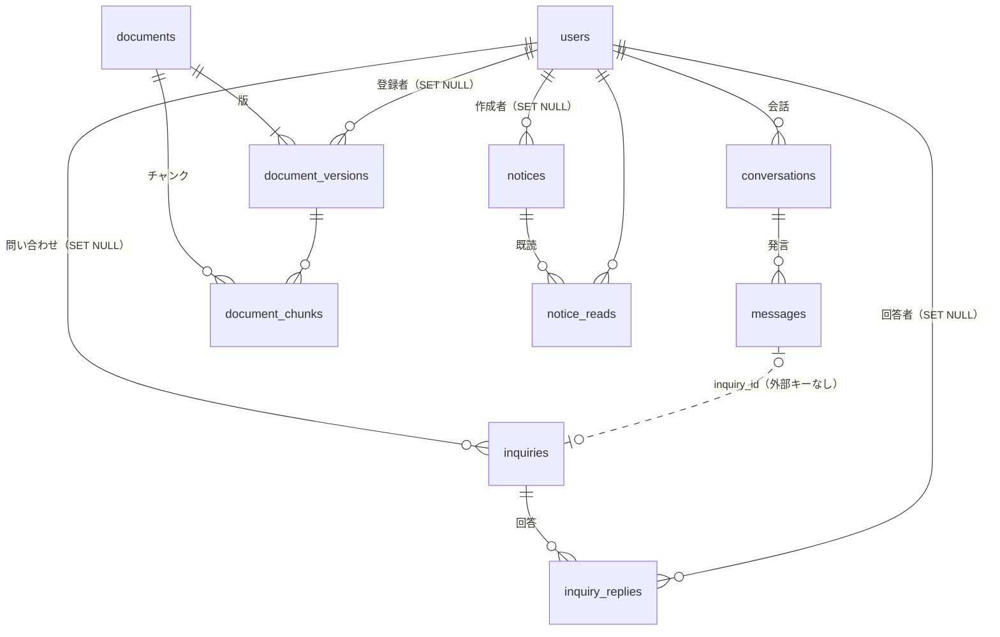

# DB 設計

PostgreSQL 17 + pgvector。テーブルは Flask-SQLAlchemy のモデル（`backend/app/models/`）で定義し、Flask-Migrate（Alembic）でマイグレーションする。

> **このドキュメントと実装が食い違う場合は、モデル（`backend/app/models/`）が正。** モデルを変えたら、この表も直す。
> 業務のルール（状態の移り方・権限）は [domain-model.md](domain-model.md)、AI の処理は [ai.md](ai.md)、API の形は [../api-spec.md](../api-spec.md)。

## 1. 方針

| 項目 | 決めたこと | 理由 |
|---|---|---|
| 主キー | `id`（integer の連番） | API では文字列にして返す（`"id": "42"`） |
| 日時 | `timestamp with time zone`。作成日時は DB の `now()` | |
| 区分値 | enum 型は使わず `varchar` ＋（必要なものは）`CHECK` 制約 | 値の追加がマイグレーションで簡単にできる |
| 部署・資料の分類 | **テーブルにせず、コードの定数**（`backend/app/masters.py`）。各テーブルには部署名の文字列を持つ | 画面から追加・変更する機能がないため。部署名を変えるときはデータの更新も必要 |
| 公開範囲・配信先の部署 | **配列の列**（`varchar[]`）。空の配列は「全員」 | 部署はテーブルにしていないので中間テーブルは作らない。絞り込みは `visible_departments @> ARRAY['営業部']` |
| ベクトル | `halfvec(3072)` ＋ HNSW 索引（コサイン距離） | text-embedding-3-large の 3072 次元。`vector` 型は 2000 次元までしか HNSW 索引を作れない |
| JSON | 画面にそのまま返す入れ子の値（処理の過程・根拠資料・設定など）は `jsonb` | 検索や集計に使わない値を、テーブルに分けずに持つ |
| 名前の写し | 問い合わせ・回答・お知らせには、作った人の氏名を写して持つ | アカウントを削除しても、誰が書いたかを表示できるようにするため |
| 削除 | 物理削除（論理削除はしない） | 削除の機能が少なく、論理削除の条件の付け忘れを防ぐため。消えるものは 7 章 |

## 2. ER 図

`app_settings` はほかのテーブルと関係しない。

## 3. テーブル一覧（11 テーブル）

| 区分 | テーブル | 内容 | モデル | マイグレーション |
|---|---|---|---|---|
| アカウント | `users` | 利用者 | `user.py` | `cb9975508bd8` |
| 資料 | `documents` | 資料（公開範囲・取り込みの状態） | `document.py` | `d79adad5597a` |
| | `document_versions` | 資料の版（原本ファイルの情報） | | |
| | `document_chunks` | 検索の単位（本文・ベクトル） | | |
| チャット | `conversations` | 会話 | `chat.py` | `952c4bfbea6b` |
| | `messages` | 質問と AI の回答（処理の過程・根拠・費用も） | | |
| 問い合わせ | `inquiries` | 担当部署への問い合わせ | `inquiry.py` | `c44ed2324f65` |
| | `inquiry_replies` | 担当部署からの回答 | | |
| お知らせ | `notices` | お知らせ | `notice.py` | |
| | `notice_reads` | 既読 | | |
| 設定 | `app_settings` | 画面から変える設定（通知設定） | | |

ほかに Alembic が使う `alembic_version` がある。利用履歴は専用のテーブルを持たず、`messages` の AI の回答から作る（4.3）。評価の結果は DB に入れず、ファイル（`backend/evaluation/runs/`）に保存する（[ai.md](ai.md)）。

## 4. テーブル定義

記号: PK＝主キー、NN＝NOT NULL、UQ＝一意、IDX＝索引あり

### 4.1 users（利用者）

| カラム | 型 | 制約 | 説明 |
|---|---|---|---|
| id | integer | PK | |
| employee_id | varchar(32) | NN, UQ | 社員番号 |
| name | varchar(100) | NN | 氏名 |
| email | varchar(255) | NN, UQ, IDX | ログイン ID。アプリで小文字にしてから保存する |
| password_hash | varchar(255) | | argon2 のハッシュ。作成・一括登録のときに管理者が決めたパスワードを必ず設定する（NULL の利用者はログインできない） |
| department | varchar(100) | NN | 所属部署。閲覧できる資料の判定に使う |
| role | varchar(16) | NN | `user`（一般利用者）/ `staff`（部署担当者）/ `admin`（管理者） |
| handles_department | varchar(100) | | 対応する部署。staff・admin が持つ。user は NULL（アプリで設定） |
| status | varchar(16) | NN | `active`（利用中）/ `suspended`（利用停止） |
| created_at | timestamptz | NN, 既定 now() | |
| last_login_at | timestamptz | | |

### 4.2 資料

#### documents（資料）

| カラム | 型 | 制約 | 説明 |
|---|---|---|---|
| id | integer | PK | |
| title | varchar(200) | NN | 資料名 |
| category | varchar(100) | | 分類（`masters.DOCUMENT_CATEGORIES`） |
| department | varchar(100) | NN | 管理部署。staff はこの部署の資料だけ管理できる |
| visibility_type | varchar(16) | NN, CHECK (`all` / `departments`) | 公開範囲 |
| visible_departments | varchar(100)[] | NN | `departments` のとき閲覧できる部署。`all` のときは空 |
| tags | varchar(50)[] | NN | タグ |
| status | varchar(16) | NN, IDX, CHECK (`processing` / `indexed` / `error`) | 取り込みの状態 |
| processing_stage | varchar(16) | | processing 中の段階: `uploaded` / `extracting` / `chunking` / `embedding` |
| processing_started_at | timestamptz | | worker が取り込みを始めた日時。30 分たっても終わらなければ取り込み直す |
| processing_attempts | integer | NN, 既定 0 | 取り込みを始めた回数。3 回を超えたら error にする（毎回 worker が止まる資料で無限に繰り返さないため） |
| error_message | text | | 取り込みに失敗した理由（画面に表示する） |
| current_version | integer | NN | 最新の版の番号 |
| created_at / updated_at | timestamptz | NN, 既定 now() | |

#### document_versions（版）

| カラム | 型 | 制約 | 説明 |
|---|---|---|---|
| id | integer | PK | |
| document_id | integer | NN, FK → documents（CASCADE） | |
| version | integer | NN | 版の番号。`(document_id, version)` で UQ |
| file_name | varchar(255) | NN | 元のファイル名 |
| file_type | varchar(16) | NN | `pdf` / `docx` / `txt` / `md` |
| size | integer | NN | バイト数 |
| pages | integer | | ページ数（PDF だけ） |
| storage_key | varchar(500) | NN | 原本の保存先（S3 のキー、または開発環境のファイルパス）。ランダムな名前 |
| effective_date | date | | 施行日 |
| note | varchar(500) | | 改定の内容 |
| uploaded_by_id | integer | FK → users（SET NULL） | 登録した人 |
| created_at | timestamptz | NN, 既定 now() | |

今は新しい版を登録する画面がないため、版は常に 1（10 章）。

#### document_chunks（チャンク）

| カラム | 型 | 制約 | 説明 |
|---|---|---|---|
| id | integer | PK | |
| document_id | integer | NN, IDX, FK → documents（CASCADE） | 公開範囲で絞り込むために持つ |
| document_version_id | integer | NN, IDX, FK → document_versions（CASCADE） | |
| chunk_index | integer | NN | 資料の中の順番 |
| section | varchar(200) | | 見出し（例: 第18条（育児休業））。根拠の表示に使う |
| page | integer | | 先頭の行のページ番号 |
| content | text | NN | 本文 |
| embedding | halfvec(3072) | NN, HNSW（`halfvec_cosine_ops`） | 「資料名 + 見出し + 本文」のベクトル |
| created_at | timestamptz | NN, 既定 now() | |

- 検索できるのは、最新の版のチャンクだけ。取り込みが終わったときに古い版のチャンクを削除し、新しい版のチャンクと同じトランザクションで入れ替える（版の行と原本は残る）
- 取り込みに失敗したときは、前の版のチャンクが残る（検索には使われ続ける）

### 4.3 チャット

#### conversations（会話）

| カラム | 型 | 制約 | 説明 |
|---|---|---|---|
| id | integer | PK | |
| user_id | integer | NN, IDX, FK → users（CASCADE） | 本人だけが見られる |
| title | varchar(200) | NN | 最初の質問の先頭 24 文字 |
| created_at / updated_at | timestamptz | NN, 既定 now() | updated_at は発言のたびに更新し、一覧の並び順に使う |

#### messages（発言）

| カラム | 型 | 制約 | 説明 |
|---|---|---|---|
| id | integer | PK | |
| conversation_id | integer | NN, IDX, FK → conversations（CASCADE） | |
| role | varchar(16) | NN | `user`（質問）/ `assistant`（AI の回答） |
| content | text | NN | 本文（回答は Markdown。根拠は `[1]` の形） |
| question | text | | 回答のもとになった質問（assistant だけ）。利用履歴に表示する |
| steps | jsonb | | 処理の過程（SSE の `step` と同じ形の配列） |
| search_count | integer | | 検索した回数 |
| duration_ms | integer | | 回答までの時間 |
| sources | jsonb | | 根拠資料（api-spec の `sources`）。**回答の時点の本文（excerpt）をコピー**して持つので、資料が改定・削除されても過去の根拠は変わらない |
| next_steps | jsonb | | 次に行う手続き |
| inquiry_suggestion | jsonb | | 問い合わせの下書き（宛先・件名・本文）。回答が `answered` 以外のときだけ |
| inquiry_id | integer | IDX | この回答から送った問い合わせ。1 つの回答から送れるのは 1 件 |
| answer_status | varchar(16) | | `answered` / `partial` / `not_found` |
| mode | varchar(16) | | `agentic`（検索Agent）/ `basic`（通常の RAG） |
| feedback | varchar(8) | | `good` / `bad` / NULL |
| input_tokens / output_tokens | integer | | 使ったトークン数（埋め込みを含む） |
| cost_usd | double precision | | 費用の目安（料金は `backend/app/ai/llm.py` の表） |
| created_at | timestamptz | NN, IDX, 既定 now() | 利用履歴の期間の絞り込みに使う |

**利用履歴**（`GET /admin/logs`）は、`role = 'assistant'` の行を会話・利用者と結合して作る。`result` は次のとおり。

| result | 条件 |
|---|---|
| `inquiry` | `inquiry_id` がある（その回答から問い合わせを送った） |
| `no_answer` | `answer_status` が `not_found` か `partial` |
| `resolved` | それ以外 |

`inquiry_id` に外部キーを付けていないのは、`messages` と `inquiries` が互いを参照する形になるのを避けるため（問い合わせは削除しないので、参照先がなくなることはない）。

### 4.4 問い合わせ

#### inquiries（問い合わせ）

| カラム | 型 | 制約 | 説明 |
|---|---|---|---|
| id | integer | PK | 受付番号は `INQ-<作成年>-<id 4 桁>`（例: INQ-2026-0142）。年ごとの連番ではない |
| user_id | integer | IDX, FK → users（SET NULL） | 送った人 |
| user_name / user_department | varchar(100) | NN | 送った時点の氏名・部署の写し |
| department | varchar(100) | NN, IDX | 宛先の部署 |
| subject | varchar(200) | NN | 件名 |
| body | text | NN | 本文（利用者が確認・編集したもの） |
| status | varchar(16) | NN, IDX, CHECK (`open` / `in_progress` / `resolved`) | 対応状況 |
| assignee | varchar(100) | | 担当者の氏名 |
| context | jsonb | NN | 元の質問・確認済みの資料・AI の回答の要約（画面から送られた値） |
| created_at / updated_at | timestamptz | NN, 既定 now() | |

#### inquiry_replies（回答）

| カラム | 型 | 制約 | 説明 |
|---|---|---|---|
| id | integer | PK | |
| inquiry_id | integer | NN, IDX, FK → inquiries（CASCADE） | |
| author_id | integer | FK → users（SET NULL） | |
| author_name | varchar(100) | NN | 回答した時点の氏名の写し |
| author_role | varchar(16) | NN | `staff` / `admin` |
| body | text | NN | |
| created_at | timestamptz | NN, 既定 now() | |

### 4.5 お知らせ・設定

#### notices（お知らせ）

| カラム | 型 | 制約 | 説明 |
|---|---|---|---|
| id | integer | PK | |
| title | varchar(200) | NN | |
| body | text | NN | |
| priority | varchar(16) | NN | `normal` / `important` |
| target_departments | varchar(100)[] | NN | 配信先の部署。空なら全員 |
| channels | varchar(16)[] | NN | `in_app` / `email`。email は保存するだけで送らない |
| publish_at | timestamptz | IDX | 配信日時。下書きは NULL |
| expire_at | timestamptz | | 掲載の終了日時 |
| is_draft | boolean | NN | 下書き |
| created_by_id | integer | FK → users（SET NULL） | |
| created_by_name | varchar(100) | NN | 作った時点の氏名の写し |
| created_at | timestamptz | NN, 既定 now() | |

- 状態（`draft` / `scheduled` / `published` / `expired`）は保存せず、`is_draft`・`publish_at`・`expire_at` と現在の時刻から求める。**予約配信は「配信日時を過ぎたら表示する」だけで実現し、定期処理は使わない**
- 画面の既読率は、表示のたびに数える（保存しない）。**既読数（`readCount`）と配信対象の人数（`targetCount`）は同じ条件で数える**: 利用停止以外の利用者のうち、今の配信先の部署の人（全員向けならすべての部署）。既読のあとに利用停止になった人や、配信先から外した部署の人の既読は数えない（数えると既読率が 100% を超えるため）

#### notice_reads（既読）

| カラム | 型 | 制約 | 説明 |
|---|---|---|---|
| id | integer | PK | |
| notice_id | integer | NN, FK → notices（CASCADE） | `(notice_id, user_id)` で UQ |
| user_id | integer | NN, IDX, FK → users（CASCADE） | |
| read_at | timestamptz | NN, 既定 now() | |

#### app_settings（設定）

| カラム | 型 | 制約 | 説明 |
|---|---|---|---|
| key | varchar(64) | PK | 設定の名前。今は `notification_settings` だけ |
| value | jsonb | NN | 設定の値（api-spec の `NotificationSettings` の形） |
| updated_at | timestamptz | NN, 既定 now() | |

行がなければ初期値（`backend/app/routes/notices.py` の `DEFAULT_NOTIFICATION_SETTINGS`）を返す。メールを送らないため、通知設定は保存するだけ。

## 5. 画面とテーブルの対応

| 画面 | 読む | 書く |
|---|---|---|
| ログイン | users | users.last_login_at |
| チャット | conversations, messages, document_chunks（検索）, documents | conversations, messages |
| 根拠資料のプレビュー・原本 | documents, document_versions（原本は S3 / ローカル） | — |
| 問い合わせの作成・履歴 | inquiries, inquiry_replies | inquiries, messages.inquiry_id |
| お知らせ・ベル | notices, notice_reads | notice_reads |
| 問い合わせ管理 | inquiries, inquiry_replies | inquiries, inquiry_replies |
| 資料一覧・アップロード | documents, document_versions, document_chunks（件数） | documents, document_versions（取り込みは worker が document_chunks に書く） |
| お知らせ配信 | notices, notice_reads, users（人数） | notices |
| 通知設定 | app_settings | app_settings |
| アカウント管理・作成 | users | users |
| 利用履歴 | messages, conversations, users | — |

## 6. アプリで必ず守るルール（スキーマでは防げないもの）

| ルール | 守る場所 |
|---|---|
| 検索・資料の閲覧・原本のダウンロードは、公開範囲の判定（`visible_to()` / `can_view()`）を必ず通す。管理者はすべて、それ以外は全員向けと所属部署向けの資料だけ | `backend/app/ai/retrieval.py`、`GET /documents/:id(/file)` |
| 検索の絞り込みは SQL の中で行う（AI に渡す前に除外する。検索の後に絞り込むと件数が足りなくなるため） | `search_chunks()` |
| staff が扱える問い合わせ・資料は、`department = handles_department` のものだけ（`handles()`） | `/admin/inquiries`、`/admin/documents` |
| 会話・メッセージは本人しか見られない（管理者は利用履歴から閲覧のみ） | チャットの API |
| 問い合わせを作れるのは利用者の送信操作のときだけ。`messageId` は本人の会話の回答で、まだ問い合わせを送っていないもの | `POST /inquiries` |
| AI の応答を待つ間は DB のトランザクションを開かない（`idle_in_transaction_session_timeout` が 60 秒） | チャットの API、worker |
| 取り込み待ちの資料は `FOR UPDATE SKIP LOCKED` で 1 件ずつ取る（worker が複数でも二重に処理しない） | `backend/app/ingestion/pipeline.py` |
| 原本を保存したあとに DB の登録に失敗したら、原本を削除する | `register_document()` |
| 長さの上限（資料名 200 文字など）は、DB に入れる前にアプリで確かめてエラーを返す | 各 API、`register_document()` |
| 管理者は自分を利用停止・降格・削除できない | `/admin/users` |

## 7. 今回作らないもの・割り切り

| 項目 | 今の作り | 影響 |
|---|---|---|
| メール | 送らない（お知らせのメール配信・通知）。招待メールの仕組みもなくした | パスワードは管理者が設定する（個別作成・CSV 一括登録は共通の初期パスワード・パスワード再設定）。「招待中」の状態はない |
| 定期処理 | 作らない（未対応の問い合わせの検知・週次レポート） | 予約配信は表示のときに判定する |
| 部署のマスタ | テーブルにしない（文字列） | 部署名を変えるときは、users・documents・inquiries・notices の部署名も更新するマイグレーションが必要 |
| 初回ログイン時のパスワード変更 | 作らない | 管理者が決めたパスワードをそのまま使う |
| アカウントの削除 | 物理削除。会話・メッセージ・既読も一緒に消える | その人の利用履歴も消える（画面の削除確認にも「会話履歴も削除されます」と表示している）。残したいときは利用停止にする |
| 問い合わせの context | 画面から送られた値を保存する | 送る人が書き換えられるが、本人の問い合わせの参考情報なので許容する |
| 資料の新しい版の登録 | 画面・API がない | 版は常に 1。改定は資料を削除して登録し直す |
| 資料の削除と過去の回答 | 資料を削除すると、版・チャンク・原本も消える。過去の回答の根拠（`messages.sources`）は本文（excerpt）・資料名・見出しをコピーして持つので残る | 過去の回答の根拠の本文は表示できるが、プレビューの施行日など（`GET /documents/:id`）と「原本を開く」（`GET /documents/:id/file`）は 404 になる。削除し直して登録した資料は別の id になるので、古い回答からはたどれない |

## 8. マイグレーション

| リビジョン | 内容 |
|---|---|
| `cb9975508bd8` | users、pgvector の有効化 |
| `d79adad5597a` | documents・document_versions・document_chunks（halfvec(3072) と HNSW 索引） |
| `952c4bfbea6b` | conversations・messages |
| `c44ed2324f65` | inquiries・inquiry_replies・notices・notice_reads・app_settings |
| `82e081ed0ed8` | 利用者の「招待中」（invited）をなくす（残っていた招待中の利用者は「利用停止」にする） |

マイグレーションは `docker compose exec api flask db migrate -m "説明"` で自動生成し、生成されたファイルを必ず読んで確認する（halfvec の型や HNSW 索引の演算子クラスは手で直すことがある）。stg では main にマージしたあとの自動デプロイで `flask db upgrade` が実行される。

## 9. 容量の見積もり

| テーブル | 想定（約 500 名の企業） | 1 行の大きさ | 合計 |
|---|---|---|---|
| document_chunks | 資料 300 件 × 100 チャンク = 3 万行 | 本文 1〜2KB ＋ ベクトル 6KB（3072 次元 × 2 バイト） | 約 250MB（HNSW を含めて約 500MB） |
| messages | 月 1,000 問 × 2 行 | 回答は処理の過程・根拠を含めて 10KB 程度 | 年 120MB 程度 |
| その他 | | | 数十 MB |

RDS のストレージ 20GB に十分収まる。stg（db.t4g.micro、メモリ 1GB）はダミー資料（23 件・約 340 チャンク）だけなので問題ない。

## 10. 未定・チームで決める項目

| 項目 | 影響 |
|---|---|
| 資料の新しい版の登録を作るか | 作るなら「新しい版をアップロード」の画面と API を追加する（テーブルは今のままでよい） |
| 取り込み直しの間・失敗したときに、前の版で検索させ続けるか | 今は前の版のチャンクが残り、検索に使われる |
| メール・定期処理を作るか | 作るなら、送信の記録や二重送信を防ぐ列（例: `notices.delivered_at`）を追加する |
| 部署をマスタにするか | 部署名の変更が必要になったら `departments` テーブルを作り、各テーブルの部署名を ID に移す |
