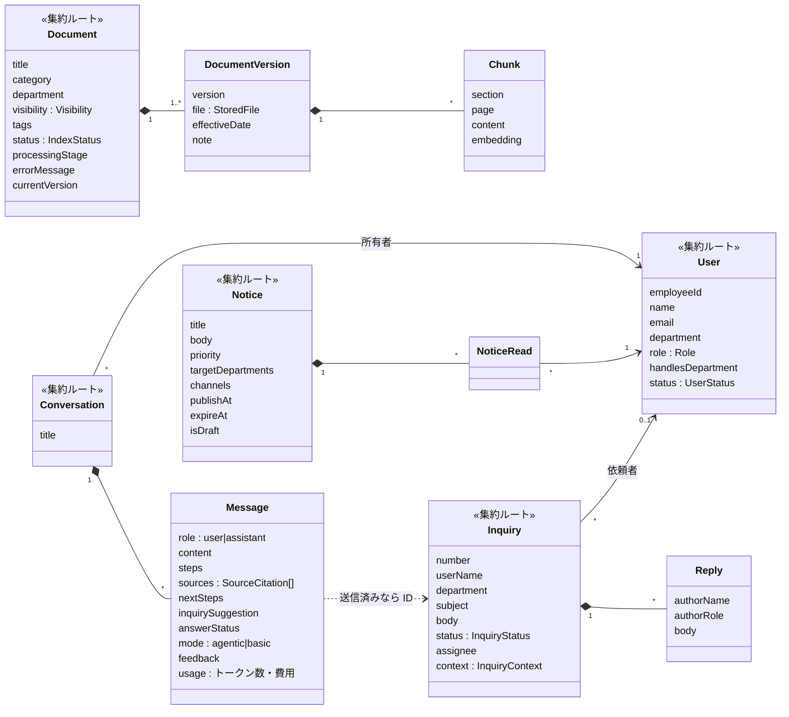
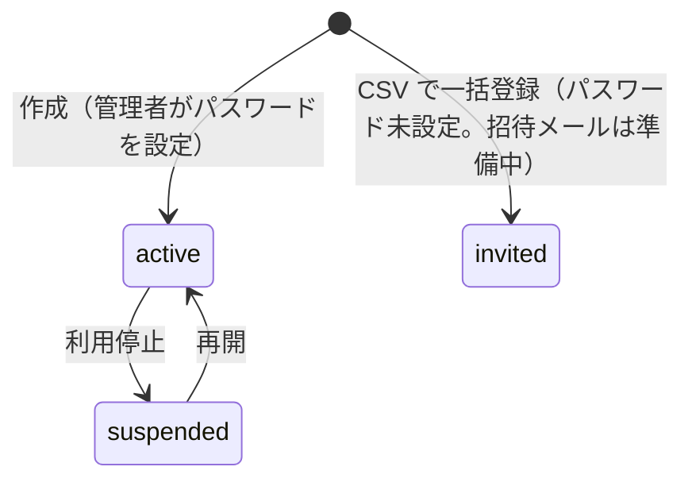
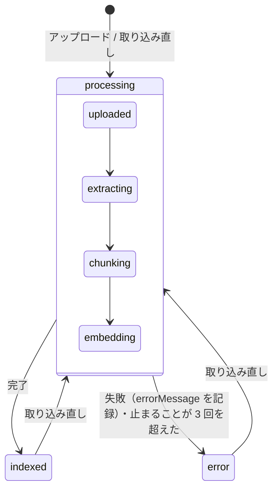
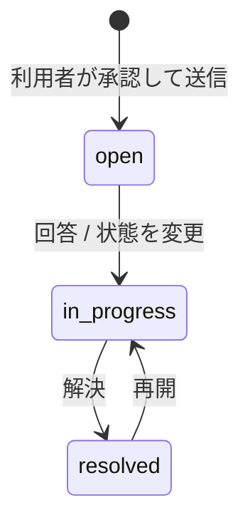

# ドメインモデル（社内ナビAI）

> 物理設計（テーブル・カラム・制約）は [db.md](db.md)。両者が食い違う場合は、実装（`backend/app/`）→ db.md → このファイルの順に正とする。
>
> **実装の状況（2026-11-10）**: main にあるのは User（ログイン）だけ。ほかの集約は、マージ待ちの PR（#10〜#13）で実装している。PR がマージされたら、この注意書きを消す。

業務の単位（集約）と、状態の移り方・ルールをまとめたもの。元にした資料: `docs/api-spec.md`、`frontend/src/mocks/`、プロジェクト計画書の別紙1（機能要件）。

- 「集約」は、一緒に保存・更新する単位（＝1 トランザクションで整合性を守る範囲）
- 集約をまたぐ参照は ID で持つ。ただし、問い合わせ・回答・お知らせには作った人の氏名を写して持つ（アカウントを削除しても表示できるように）

## 1. 全体像

| 区分 | 集約（ルート） | 中に含むもの | テーブル | 主な利用者 |
|---|---|---|---|---|
| アカウント | **User** | — | `users` | 管理者 |
| 資料 | **Document** | DocumentVersion、Chunk | `documents`・`document_versions`・`document_chunks` | 部署担当者・管理者 |
| チャット | **Conversation** | Message（処理の過程・根拠資料・次の手続き・問い合わせの下書きは Message の JSON） | `conversations`・`messages` | 利用者 |
| 問い合わせ | **Inquiry** | Reply、InquiryContext | `inquiries`・`inquiry_replies` | 利用者・部署担当者 |
| お知らせ | **Notice** | NoticeRead | `notices`・`notice_reads` | 部署担当者・管理者 |
| 通知設定 | **NotificationSettings**（1 件だけ） | EventRule、DepartmentContact、WeeklyReport | `app_settings` の JSON | 管理者 |
| マスタ | Department、DocumentCategory | — | なし（`backend/app/masters.py` の定数） | — |

利用履歴は集約を持たず、Message（AI の回答）から作る。



## 2. 共通の値

| 名前 | 形 | 説明 |
|---|---|---|
| `Role` | `user` \| `staff` \| `admin` | 権限。staff と admin は `handlesDepartment`（対応する部署）を持つ |
| `Visibility` | `{type:"all"}` \| `{type:"departments", departments:[…]}` | 資料の公開範囲。お知らせの配信先も同じ形 |
| `StoredFile` | `{fileName, fileType, size, pages, storageKey}` | 原本ファイル。`storageKey` は S3 か開発環境のファイルの場所 |
| `InquiryNumber` | `INQ-<作成年>-<id 4 桁>` | 受付番号。id から作るので、年ごとの連番ではない |

公開範囲の判定は 1 か所（`backend/app/ai/retrieval.py` の `visible_to()` / `can_view()`）に置く。

```python
def can_view(document, user) -> bool:
    return user.role == "admin" or document.visibility_type == "all" or user.department in document.visible_departments
```

## 3. 集約ごとのルール

### User
- `email`・`employeeId` はそれぞれ一意（重複は 409）。email は小文字にそろえる
- `user` は `handlesDepartment` を持たない。staff・admin は持つ（指定がなければ所属部署）
- 管理者は自分を利用停止・降格・削除できない
- 削除は物理削除。その人の会話（と利用履歴）も消える。履歴を残したいときは利用停止にする



### Document（資料）
- 検索の対象は、`Visibility` が利用者を含む資料の、最新の版の Chunk だけ（検索の SQL の中で絞り込む）
- 部署担当者が登録・変更・削除できるのは、自分の担当部署の資料だけ。管理者はすべて
- 取り込みは worker が行う。止まった取り込みは 30 分後に取り込み直し、3 回を超えたら error にする
- error の資料は自動では取り込み直さない。資料管理の画面の「取り込み直し」で取り込み直す
- 取り込みが終わったら、古い版の Chunk を新しい版の Chunk に入れ替える。失敗したときは前の版の Chunk が残る



### Conversation（チャット）
- 会話を見られるのは所有者だけ（管理者は利用履歴から閲覧のみ）
- AI の回答（assistant の Message）は、処理の過程・検索回数・時間・根拠資料・トークン数・費用を持つ
- 根拠資料（SourceCitation）は回答の時点の本文をコピーして持つ。資料が改定・削除されても、過去の回答の根拠は変わらない。`index` は本文の `[1]` などと対応する。ただし資料を削除すると、プレビューの資料の情報と原本は開けなくなる（404）
- 根拠が見つからないときは、AI に回答を作らせず決まった文を返す（推測で答えない）
- 問い合わせの下書き（InquirySuggestion）は、回答が `answered` 以外（`partial` / `not_found`）のときだけ付く
- `feedback` は AI の回答だけに付けられる。何度でも変更・取り消しできる

利用履歴の `result` は、回答の状態と問い合わせの有無から決まる。

| result | 条件 |
|---|---|
| `inquiry` | その回答から問い合わせを送った |
| `no_answer` | 資料に答えがなかった、または一部だけ答えた |
| `resolved` | それ以外（自己解決） |

### Inquiry（問い合わせ）
- 作成は、利用者が確認画面で「承認して送信」を押したときだけ（AI が自動で作らない）
- 元の回答（Message）とつなぐ。1 つの回答から送れる問い合わせは 1 件
- 閲覧・対応できるのは、送った本人・宛先の部署を担当する staff・admin
- staff・admin が回答すると、`open` のものは `in_progress` に進み、担当者が未設定なら回答した人が担当者になる



### Notice（お知らせ）
- 状態は保存せず、`isDraft`・`publishAt`・`expireAt` と現在の時刻から求める（予約配信に定期処理は使わない）

| status | 条件 |
|---|---|
| `draft` | `isDraft = true` |
| `scheduled` | `publishAt > 現在` |
| `expired` | `expireAt < 現在` |
| `published` | それ以外 |

- 利用者に見せるのは `published` で、配信先が全員か利用者の部署を含むもの
- `readCount`（既読数）と `targetCount`（配信対象の人数）は、表示のときに**同じ条件**で数える: 利用停止の人を除き、今の配信先の部署の人。既読のあとに利用停止になった人や、配信先から外した部署の人の既読は数えない（既読率が 100% を超えないように）
- メールでの配信は今は行わない（`channels` の email は保存するだけ）

### NotificationSettings（通知設定）
- システムに 1 件だけ。`EventRule.key` は `inquiry_created` / `inquiry_replied` / `inquiry_overdue` / `document_indexed` / `document_failed` / `low_rating`
- メール・定期処理を作らないため、今は**保存するだけ**で、通知は送らない

## 4. 今回作らないもの
メールの送信（招待・パスワード再設定・お知らせ・通知）と、定期処理（未対応の問い合わせの検知・週次レポート）は作らない。詳しくは [db.md の 7 章](db.md#7-今回作らないもの割り切り)。
