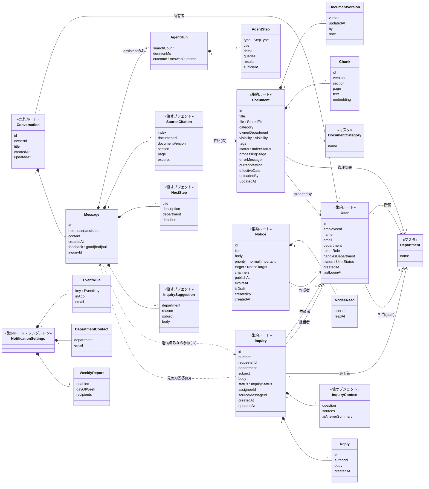
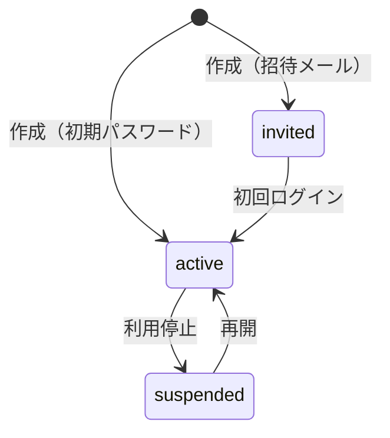
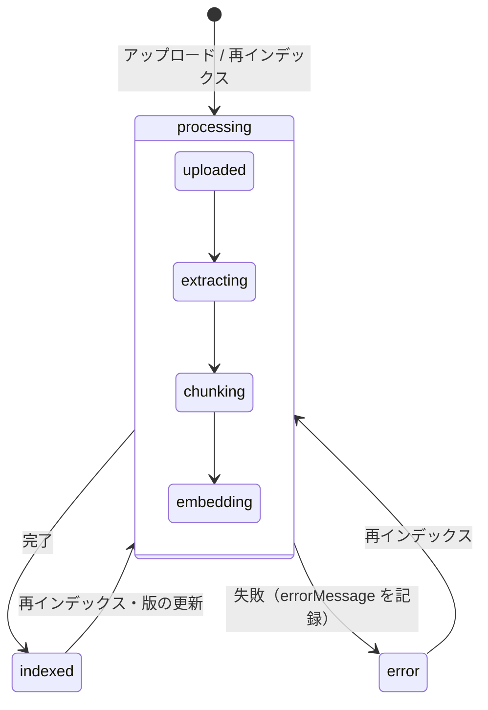
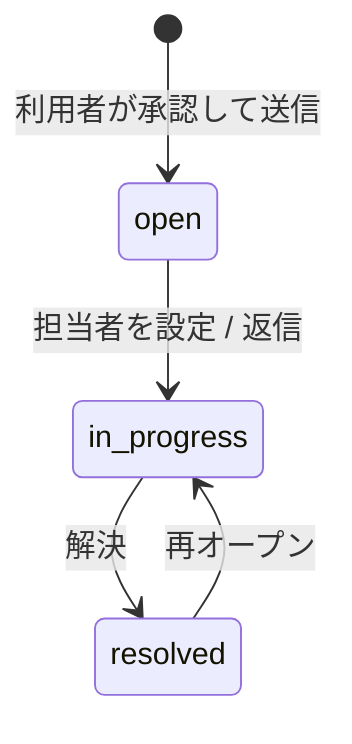

# ドメインモデル（社内ナビAI）

> 物理設計（テーブル・カラム・制約）は [db.md](db.md)。両者が食い違う場合は db.md を正とする。

Flask バックエンドのテーブル設計・クラス設計の土台にするためのドメインモデルです。
元にした資料：`docs/api-spec.md`、`src/mocks/`（db・agent・handlers）、各画面のコンポーネント、画面スクリーンショット、`document/機能マッピング表.xlsx`、プロジェクト計画書の別紙1（機能要件）。

図：本ファイル内の Mermaid 図を参照（元の画像はモックアップのリポジトリにある）

- 「集約」は、一緒に保存・更新する単位（＝1 トランザクションで整合性を守る範囲）です
- 集約をまたぐ参照は **ID で持ちます**。モックの `userName`・`uploadedBy`・`author` のような名前の重複保持は、API のレスポンスを組み立てるときに JOIN して付け足す想定です

## 1. 全体像

| 区分 | 集約（ルート） | 中に含むもの | 主な利用者 |
|---|---|---|---|
| アカウント | **User** | — | 管理者 |
| ナレッジ | **Document** | DocumentVersion、Chunk | 部署担当者・管理者 |
| チャット | **Conversation** | Message、AgentRun、AgentStep、SourceCitation、NextStep、InquirySuggestion | 利用者 |
| 問い合わせ | **Inquiry** | Reply、InquiryContext | 利用者・部署担当者 |
| お知らせ | **Notice** | NoticeRead | 部署担当者・管理者 |
| 通知設定 | **NotificationSettings**（シングルトン） | EventRule、DepartmentContact、WeeklyReport | 管理者 |
| マスタ | Department、DocumentCategory | — | — |
| 利用分析 | **UsageLog** | — | 管理者 |



## 2. 共通の値オブジェクト

| 名前 | 形 | 説明 |
|---|---|---|
| `Role` | `user` \| `staff` \| `admin` | 権限。`staff` は `handlesDepartment` が必須 |
| `Visibility` | `{type:"all"}` \| `{type:"departments", departments:[…]}` | 資料の公開範囲 |
| `NoticeTarget` | `Visibility` と同じ形 | お知らせの配信対象。同じクラス（`Audience`）にまとめてよい |
| `StoredFile` | `{fileName, fileType, size, pages, storageKey}` | 原本ファイル。`storageKey` は S3 などの保存先 |
| `InquiryNumber` | `INQ-YYYY-NNNN` | 年ごとの連番（JST の年）。採番はカウンタ用のテーブルで行う（[db.md](db.md) の `inquiry_number_counters`） |

`Audience`（Visibility／NoticeTarget）の判定ルールは 1 か所に置きます。

```python
def includes(audience, user) -> bool:
    return audience.type == "all" or user.department in audience.departments
```

## 3. 集約ごとのルール（不変条件）

### User
- `email`・`employeeId` はそれぞれ一意（重複は 409）
- `role = staff` のときは `handlesDepartment` が必須。`user` のときは `null`。`admin` は任意
- 削除しても、問い合わせや資料の履歴から名前を表示できるようにする（論理削除を推奨）



### Document（ナレッジ）
- バージョンを上げるたびに `DocumentVersion` を 1 件追加し、`Chunk` は新しいバージョンで作り直す
- 検索対象は `status = indexed` かつ `Visibility` が利用者を含む資料の、**最新バージョンの Chunk だけ**
- 再インデックスは `indexed` または `error` のときに実行できる



### Conversation（チャット）
- 会話を見られるのは所有者だけ（管理者は利用履歴から閲覧のみ）
- `assistant` の Message は必ず `AgentRun` を持つ。`SourceCitation.index` は本文中の `[1]` などと対応する
- `SourceCitation` は回答時点の `documentVersion` と `excerpt` をコピーして持つ。資料が更新・削除されても、過去の回答の根拠は変わらない
- `InquirySuggestion` は Agent が「社内資料だけでは解決できない」と判断したときだけ付く
- `feedback` は `assistant` の Message だけに付けられる。何度でも変更・取り消しできる

`AgentRun.outcome` は AI の実行結果（`answered` / `no_answer` / `stopped` / `error`）です。利用履歴の `result` は、これと問い合わせの有無から次のように決まります。

| result（利用履歴） | 条件 |
|---|---|
| `resolved` | 根拠ありで回答し、問い合わせは送っていない |
| `inquiry` | その回答から問い合わせが送信された（`Message.inquiryId` あり） |
| `no_answer` | 根拠が見つからず回答しなかった |

### Inquiry（問い合わせ）
- 作成は、利用者が確認画面で承認したときだけ（AI が自動で作らない）
- 作成時に元の Message から `InquiryContext`（質問・根拠・AI 回答の要約）をコピーし、元の Message の `inquiryId` を埋める。1 つの Message から作れる問い合わせは 1 件
- 閲覧・対応できるのは、依頼者本人・`department = handlesDepartment` の staff・admin
- `assignee` は、あて先部署を担当する staff か admin
- staff/admin が返信すると、`open` のものは `in_progress` に進み、担当者が未割当なら返信した人が担当者になる



### Notice（お知らせ）
- `status` は保存せず、`isDraft`・`publishAt`・`expireAt` と現在時刻から求める

| status | 条件 |
|---|---|
| `draft` | `isDraft = true` |
| `scheduled` | `publishAt > 現在` |
| `published` | `publishAt ≦ 現在`（null は即時）かつ（`expireAt` が null または `expireAt > 現在`） |
| `expired` | `expireAt ≦ 現在` |

- 利用者に見せるのは `published` かつ `target` が利用者を含むもの
- `readCount` は `NoticeRead` の件数、`targetCount` は配信時点で `target` に含まれる有効ユーザー数

### NotificationSettings
- システムに 1 件だけ。`EventRule.key` は次の固定セット：
  `inquiry_created` / `inquiry_replied` / `inquiry_overdue` / `document_indexed` / `document_failed` / `low_rating`

## 4. ドメインイベントと通知

各集約の変更でイベントを発行し、`NotificationSettings` の設定に従って通知を送ります。

| イベント | 発生元 | 通知先 |
|---|---|---|
| `inquiry_created` | Inquiry 作成 | あて先部署の staff（＋`DepartmentContact` のメール） |
| `inquiry_replied` | Reply 追加 | 依頼者 |
| `inquiry_overdue` | 定期ジョブ（3 営業日以上 `open`） | あて先部署の staff・admin |
| `document_indexed` | Document → `indexed` | アップロードした人 |
| `document_failed` | Document → `error` | アップロードした人・admin |
| `low_rating` | Message の feedback が `bad` | admin |

## 5. 利用分析（UsageLog）

機能マッピング表のとおり `usage_logs` テーブルとして持ちます。質問 1 件（assistant の Message 1 件）につき 1 行を記録し、会話が削除されても利用履歴は残ります。

- 記録時の `result` は、問い合わせ提案があれば `no_answer`、なければ `resolved`
- 問い合わせを送信すると `inquiry` に変わり、Message の評価を変えると `feedback` も変わる
- 集計（質問数・自己解決率・平均検索回数・平均応答時間・高評価率・削減時間＝自己解決 1 件 × 20 分）はこのテーブルから計算する

## 6. テーブルの対応（目安）

| 集約 | テーブル |
|---|---|
| User | `users` |
| Department／DocumentCategory | `departments`、`document_categories` |
| Document | `documents`、`document_versions`、`chunks`（ベクトル列つき） |
| Conversation | `conversations`、`messages`（NextStep・InquirySuggestion は JSON 列）、`agent_runs`（AgentStep は JSON 列）、`source_citations` |
| Inquiry | `inquiries`、`inquiry_replies`（InquiryContext は JSON 列） |
| Notice | `notices`、`notice_reads` |
| NotificationSettings | `notification_settings`（イベントは JSON 列）、`department_contacts` |
| UsageLog | `usage_logs` |

`Visibility`・`NoticeTarget` の部署リストは、検索の絞り込みで使うので JSON 列ではなく中間テーブル（`document_visible_departments` など）にするのがおすすめです。
